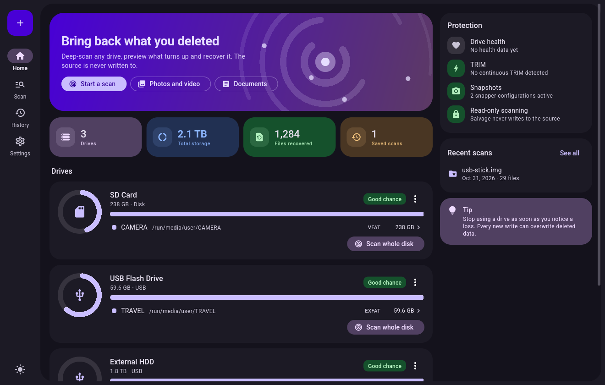
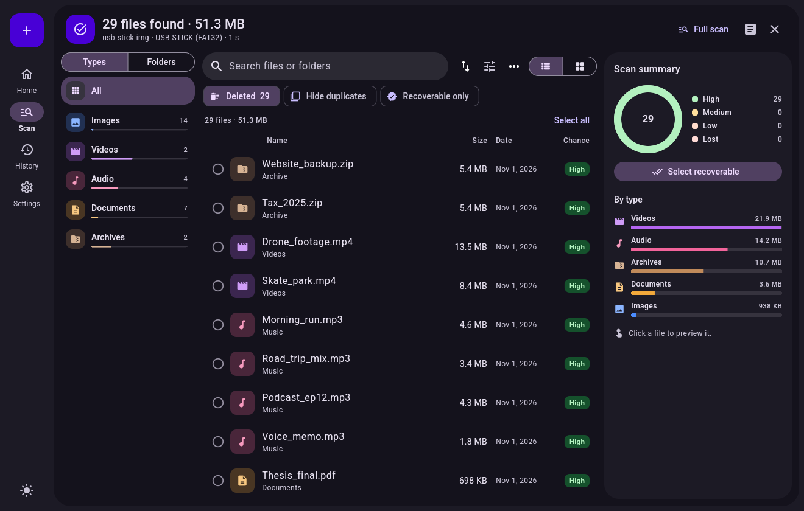
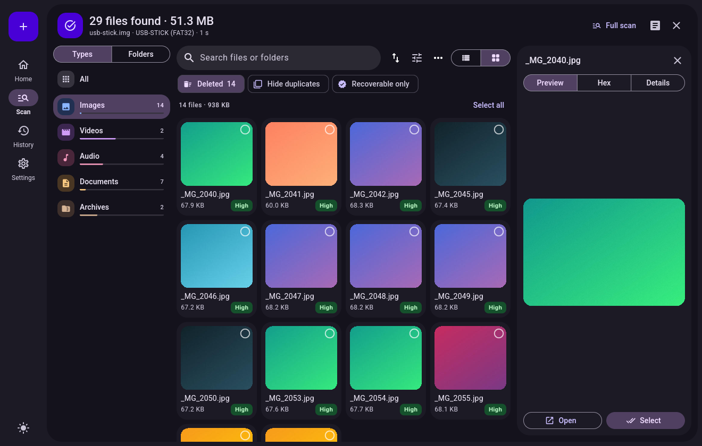
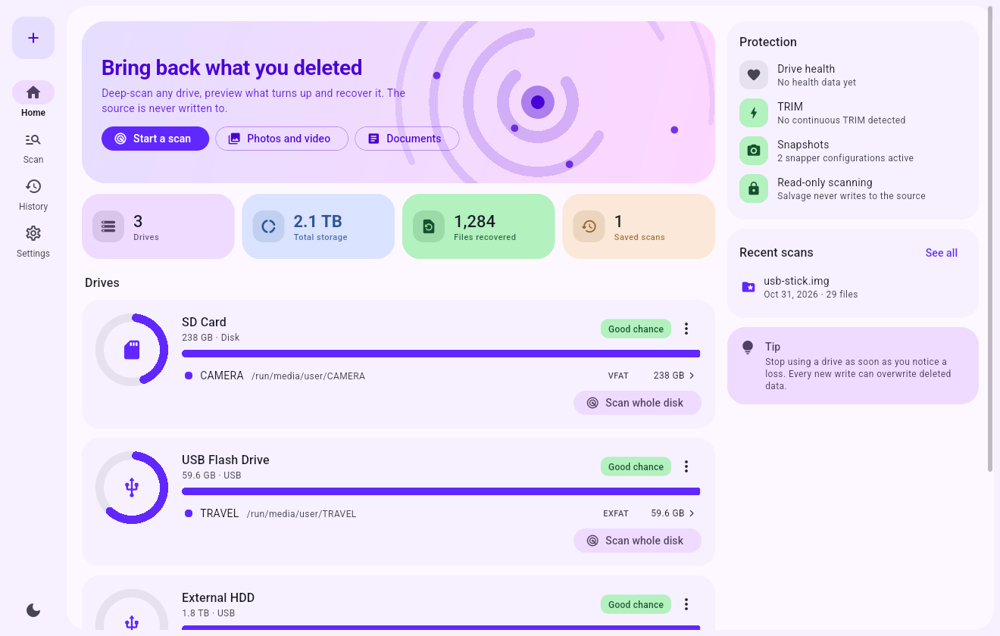

<p align="center">
  
</p>

<h1 align="center">Salvage</h1>

<p align="center">
  Bring back deleted files on Linux. Plug in a drive, pick it, see what can be recovered.
</p>

<p align="center">
  <a href="https://github.com/egcax/salvage/releases/latest"></a>
  <a href="https://github.com/egcax/salvage/releases"></a>
  <a href="LICENSE"></a>
  
  
</p>

<p align="center">
  
</p>

> [!IMPORTANT]
> **Lost something right now?** Stop using that drive and do not install Salvage onto it.
> Every new write can overwrite the data you want back.

> [!NOTE]
> **Status: beta.** Tested on real file systems with byte-exact verification, but only on
> one machine so far. Never rely on a recovery tool as your only copy of important data.

## Download

| System | File | Install |
|---|---|---|
| Arch, CachyOS, Manjaro | [`salvage-2.1.2-1-x86_64.pkg.tar.zst`](https://github.com/egcax/salvage/releases/latest/download/salvage-2.1.2-1-x86_64.pkg.tar.zst) | `sudo pacman -U salvage-*.pkg.tar.zst` |
| Debian, Ubuntu, Mint | [`salvage_2.1.2_amd64.deb`](https://github.com/egcax/salvage/releases/latest/download/salvage_2.1.2_amd64.deb) | `sudo apt install ./salvage_*.deb` |
| Fedora, openSUSE | [`salvage-2.1.2-1.x86_64.rpm`](https://github.com/egcax/salvage/releases/latest/download/salvage-2.1.2-1.x86_64.rpm) | `sudo dnf install ./salvage-*.rpm` |
| Any other distribution | [`Salvage-2.1.2-x86_64.AppImage`](https://github.com/egcax/salvage/releases/latest/download/Salvage-2.1.2-x86_64.AppImage) | `chmod +x Salvage-*.AppImage && ./Salvage-*.AppImage` |

Packages are the better choice: they add SMART health data and the option to scan without
a password. The AppImage needs GTK 3 from your system and asks for your password on every
scan. Checksums are in `SHA256SUMS` on the [release page](https://github.com/egcax/salvage/releases/latest).

Optional tools add features: `smartmontools` (health), `udisks2` (unmount),
`ffmpegthumbnailer` and `ffmpeg` (video previews), `poppler` (PDF previews).

## Screenshots

| Results | Preview |
|---|---|
|  |  |

<details>
<summary>Light theme</summary>



</details>

## Features

**Finding files**
- File system parsers for FAT12/16/32, exFAT, NTFS, ext2/3/4, btrfs and F2FS
- Signature search for 40+ formats, with free-space maps so existing files are not listed
- Lost partition search, including partitions missing from the table
- ext3/4 journal replay: recovers files whose metadata the kernel already wiped
- btrfs stale tree scanning, snapshot comparison and zstd, lzo and zlib decompression
- Unlocked LUKS and LVM volumes
- JPEG reassembly when a photo is split into two fragments

**Knowing what will work**
- Recovery chance for every file; on btrfs it is measured against stored checksums
- Open-and-check verification for images, ZIP-based documents, media, PDF and SQLite
- Duplicate detection
- Warnings for TRIM, mounted disks and failing drives

**Protecting your data**
- The source is opened read-only and no code path writes to it
- TRIM pause during a scan, restored automatically even if Salvage crashes
- Emergency rescue copies the best candidates to memory the moment they are found
- Previews stay in RAM; destination on the scanned partition requires explicit consent
- Disk imaging with bad sector retries and resume

**Everyday use**
- Live results during a scan, recover while still scanning
- Pause, stop and resume scans; saved sessions
- List and grid views, folder tree, filters, search inside files
- Export the list as CSV, JSON or HTML; SHA-256 verified recovery with a report
- SMART health, speed limit, low-priority mode, keyboard shortcuts
- Light and dark themes, wallpaper accent color, 24 languages

## How it works

```
Flutter UI ── JSON lines ── salvage-engine (Rust)
                             │
        started with pkexec, opens the device read-only, reads SMART,
        then permanently drops to your user (uid, gid, groups, no_new_privs)
```

Disk structures are untrusted input and are parsed without privileges. A small root process
exists only when TRIM pause is on, to restore the mount option when the engine exits.

## Limits

No recovery software can do these, and Salvage does not pretend otherwise:

- **SSDs with TRIM:** erased data is gone. On a test NVMe with `discard=async`, a 5 MB file
  disappeared about a minute after deletion. Enable snapshots for real protection.
- **Fragmented files by signature:** only JPEG split into two pieces is reassembled.
- **ext2:** the kernel fragments files and erases pointers; only small files come back.
- **XFS:** current kernels wipe deleted inodes, so only signature search works.
- **NTFS deleted on Linux:** `ntfs3` removes the name, so content returns without it.
- **F2FS:** often mounted with discard, which erases data quickly.
- **HFS+ and APFS:** signature search only.
- **Multi-device btrfs:** RAID1, RAID10, RAID5 and RAID6 metadata is not reassembled.

## Build from source

Requires Rust, Flutter 3.47 and GTK 3 development files.

```sh
./build.sh
sudo pacman -U packaging/salvage-*.pkg.tar.zst
```

On other distributions, run the `cargo` and `flutter` steps from `build.sh`, then
`packaging/linux/make-packages.sh` with [fpm](https://github.com/jordansissel/fpm) installed.

## Tests

```sh
SALVAGE_SUDO=... python3 tests/run_tests.py   # real file systems, SHA-256 comparison
SALVAGE_SUDO=... python3 tests/v2_tests.py    # bad sectors, LUKS, TRIM, resume and more
```

`SALVAGE_SUDO` holds your sudo password for the test run. The tests create loop devices, so
hide them from desktop automounters first, or a polkit dialog may appear: add a udev rule
setting `UDISKS_IGNORE=1` for `loop*` and `dm-*`.

## Translations

Files live in `app/assets/i18n/` as `key: text` JSON, and `tools/check_i18n.py` validates
them. Most were written by machine and have not been reviewed by native speakers, so
[corrections are very welcome](https://github.com/egcax/salvage/issues/new?template=translation.yml).

## License

[MIT](LICENSE). The bundled Roboto font is under the
[Apache License 2.0](app/assets/fonts/LICENSE.txt).
